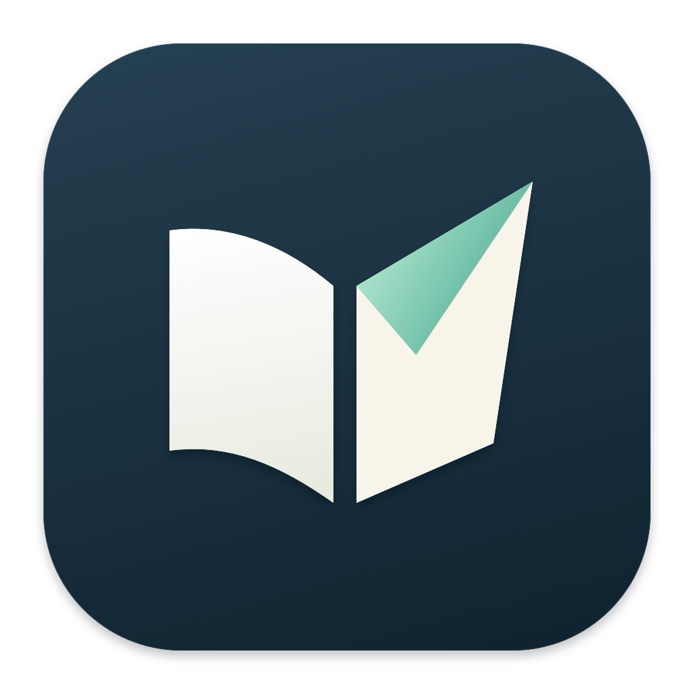
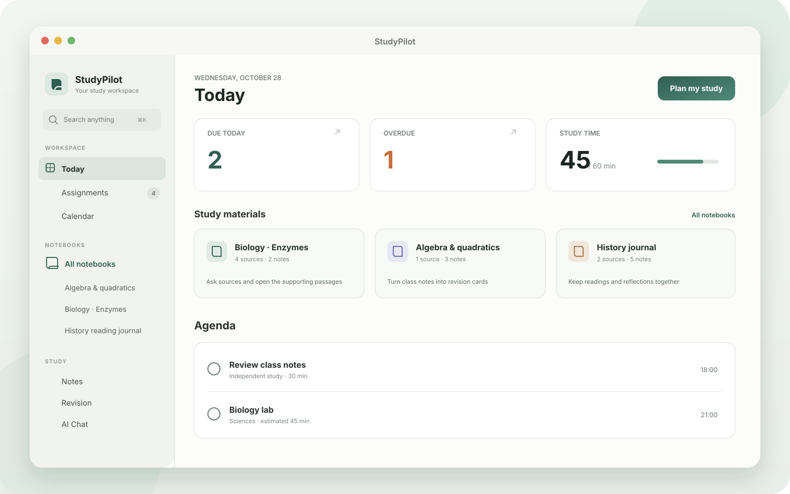

<p align="center">
  
</p>

<h1 align="center">StudyPilot</h1>

<p align="center">
  A private, native student workspace for macOS and Windows.
</p>

<p align="center">
  <a href="https://github.com/Sumi1124/StudyPilot/releases/latest/download/StudyPilot-macOS.zip">
    
  </a>
  <a href="https://github.com/Sumi1124/StudyPilot/releases/download/windows-v1.0.0/StudyPilot-Windows-x64.zip">
    
  </a>
  <a href="https://github.com/Sumi1124/StudyPilot/releases/latest">
    
  </a>
</p>

<p align="center">
  
  
  
  
  
  
</p>

<p align="center">
  
</p>

## One place for the whole school week

StudyPilot combines the work students usually split across a task manager, calendar, notebook, flashcard app, and timer. Both editions are native desktop apps, store their workspace locally, and do not require an account for their core features. The mature macOS edition has the complete feature set; the new Windows edition begins with assignments, study planning, notes, focus, and backups.

New on macOS in **1.19.1**: select IB MYP or DP in Settings. MYP students can track criteria A–D and Personal Project work; DP students can tag IAs, EE, TOK, CAS, exams, and coursework, see the next deadlines, and track open work in Academic progress. StudyPilot keeps these as personal planning records rather than predicting official IB grades. Repeated study sessions and calendar events still appear once per day with expandable time slots.

<table>
  <tr>
    <td width="50%" valign="top">
      <h3>Plan around real commitments</h3>
      <p>Bring in calendars already connected to macOS, choose assignments, set study hours, and review conflict-free study blocks before saving them.</p>
    </td>
    <td width="50%" valign="top">
      <h3>Study from your own sources</h3>
      <p>Collect PDFs, text, Markdown, and class notes in notebooks. Search passages without AI or ask a local model and open the exact excerpts behind its answer.</p>
    </td>
  </tr>
  <tr>
    <td width="50%" valign="top">
      <h3>Keep work actionable</h3>
      <p>Track deadlines and manual checklists, estimate remaining time, check off finished work, and automatically reschedule an unfinished StudyPilot block after it ends.</p>
    </td>
    <td width="50%" valign="top">
      <h3>Remember what you learn</h3>
      <p>Write linked Markdown notes, turn <code>Question :: Answer</code> lines into editable flashcards, review with spaced repetition, and record focused study time.</p>
    </td>
  </tr>
</table>

## Download

<p align="left">
  <a href="https://github.com/Sumi1124/StudyPilot/releases/latest/download/StudyPilot-macOS.zip">
    
  </a>
  <a href="https://github.com/Sumi1124/StudyPilot/releases/download/windows-v1.0.0/StudyPilot-Windows-x64.zip">
    
  </a>
</p>

### macOS

Supports **Apple Silicon Macs running macOS 14 or later**.

1. Download and unzip `StudyPilot-macOS.zip`.
2. Move `StudyPilot.app` to Applications if you want.
3. Open the app and create your workspace.
4. Future signed updates are available inside **Settings → Check for Updates**.

The public build is ad-hoc signed for development and is not Apple-notarized. The source and exact validation record are available in this repository so the build can be inspected or reproduced. See the [latest release](https://github.com/Sumi1124/StudyPilot/releases/latest) for the current version and archive.

### Windows

Supports **64-bit Windows 10 and Windows 11**.

1. Download and unzip `StudyPilot-Windows-x64.zip`.
2. Open `StudyPilot.exe`.
3. Your workspace is stored locally under `%LOCALAPPDATA%\StudyPilot`.

The Windows build is self-contained, so it does not require a separate .NET installation. It is not yet code-signed; Windows SmartScreen may show a warning on first launch. Windows has its own `1.x` release line and does not change the macOS version.

## What is included on macOS

| Area | What it does |
| --- | --- |
| **Today** | A guided deadline → plan → focus journey, due and overdue counts, study-time progress, notebook shortcuts, agenda, quick capture, and seven-day workload. |
| **Assignments** | Subjects, projects, deadlines, reminders, priorities, manual checklists, completion, bulk actions, and reviewed time estimates. |
| **Calendar** | Local planner events plus selected calendars synced through macOS Calendar. |
| **Plan my study** | Optional local-AI schedule coaching, deadline-first scheduling around busy time, study routines, daily limits, breaks, preview, and explicit save. |
| **Notebooks** | PDF/text/Markdown sources, passage search, local source questions with references, notes, and flashcard creation. |
| **Notes & revision** | Markdown, tags, wiki-style note links, backlinks, decks, review history, and spaced repetition. |
| **Focus & progress** | Recoverable timers, daily goals, study history, criterion scores, trends, and personal targets. |
| **AI Chat** | Local study help, saved-workspace facts, optional calendar context, and reviewed calendar move proposals. |

## What is included on Windows

| Area | What it does |
| --- | --- |
| **Today** | Due-soon work, upcoming study blocks, completion totals, and focus progress. |
| **Assignments** | Subjects, deadlines, priorities, completion, and estimated study time. |
| **Study plan** | Splits estimates into focused sessions and reschedules missed unchecked blocks. |
| **Notes** | Keeps personal class and revision notes locally on the PC. |
| **Focus** | A 25-minute focus timer connected to the current assignment list. |
| **Data** | Local JSON persistence, migration from the preview, and backup import/export. |

## Local-first AI

Apple Intelligence is the default AI provider on compatible Macs running macOS 26 or later. StudyPilot also supports the optional `qwen3.5:0.8b-q8_0` model through Ollama on `127.0.0.1`.

- AI is optional; assignments, scheduling, notes, revision, timers, and backups work without it.
- Qwen downloads only when you press the explicit download button.
- There is no automatic model fallback or silent download.
- Calendar changes are previewed and require **Apply**.
- AI schedule coaching receives free-time totals rather than calendar event names and only proposes planner settings.
- Source answers show the original passages so you can check the model's interpretation.
- StudyPilot does not generate assignment solutions or suggested assignment steps.

The notebook workspace is inspired by source-based study tools. It does not connect to Google's NotebookLM service.

## Google Calendar

StudyPilot uses EventKit, so Google Calendar remains managed by macOS:

1. Add your Google account in **System Settings → Internet Accounts**.
2. Enable Calendar for the account.
3. Open **Plan my study** in StudyPilot and grant calendar access.
4. Choose deadline calendars, busy calendars, and a writable destination.

StudyPilot reads only the calendars you select. It writes after you review a plan or calendar change. Full setup and behavior are documented in [GOOGLE-CALENDAR.md](GOOGLE-CALENDAR.md).

## Build from source

### Xcode

1. Install Xcode 16 or newer.
2. Open `StudyPilot.xcodeproj`.
3. Select the **StudyPilot** scheme and **My Mac**.
4. Press **⌘R**.

### Command line

```sh
./Scripts/build-app.sh
./Scripts/test.sh
```

The build script produces an optimized Apple Silicon app at `dist/StudyPilot.app`. The test script supports both full Xcode and standalone Command Line Tools.

### Windows

Install the .NET 8 SDK on Windows, then run:

```powershell
.\Windows\build.ps1
```

The self-contained executable is written to `Windows\dist\win-x64\StudyPilot.exe`. See [Windows/README.md](Windows/README.md) for Windows-specific details.

## Useful shortcuts

| Shortcut | Action |
| --- | --- |
| `⌘N` | New assignment |
| `⇧⌘N` | New note |
| `⌘K` | Search the workspace and run quick actions |
| `⇧⌘P` | Open Plan my study |
| `⇧⌘F` | Start or open a focus session |
| `⇧⌘D` | Switch between light and dark appearance |
| `⌘,` | Open Settings |
| `Space` | Reveal a flashcard answer |
| `1–4` | Rate a revealed flashcard |

<details>
<summary><strong>Storage, backups, and privacy</strong></summary>

The standard app stores its workspace at:

```text
~/Library/Application Support/StudyPilot/StudyPilot.store
~/Library/Application Support/StudyPilot/Backups/
```

StudyPilot creates a local automatic backup on the first launch each day. Settings also provides manual backup, portable JSON export, and validated restore. Imported notebook text and saved cited answers are included in workspace backups. Calendar account authentication and synchronization remain with macOS.

The app does not include an analytics SDK and does not upload its workspace database. Optional in-app updates connect to this GitHub repository. Optional Qwen chat is restricted to the local Ollama loopback endpoint. See [ARCHITECTURE.md](ARCHITECTURE.md) for the complete data and privacy boundaries.

</details>

## Project documentation

| Document | Contents |
| --- | --- |
| [ARCHITECTURE.md](ARCHITECTURE.md) | Data model, save boundaries, scheduling, AI context, and safety rules |
| [VALIDATION.md](VALIDATION.md) | Tests, native UI checks, release verification, and known limits |
| [GOOGLE-CALENDAR.md](GOOGLE-CALENDAR.md) | Calendar setup and planner workflow |
| [UPDATES.md](UPDATES.md) | Signed Sparkle release process |
| [PROGRESS.md](PROGRESS.md) | Implementation status by feature |

<p align="center">
  <a href="https://github.com/Sumi1124/StudyPilot/releases/latest/download/StudyPilot-macOS.zip"><strong>Download for macOS</strong></a>
  ·
  <a href="https://github.com/Sumi1124/StudyPilot/releases/download/windows-v1.0.0/StudyPilot-Windows-x64.zip"><strong>Download for Windows</strong></a>
  ·
  <a href="https://github.com/Sumi1124/StudyPilot/releases/latest">Release notes</a>
  ·
  <a href="VALIDATION.md">Validation</a>
</p>
